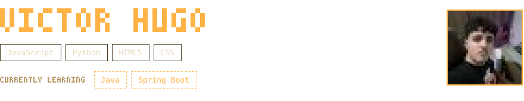
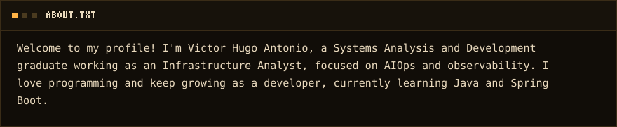
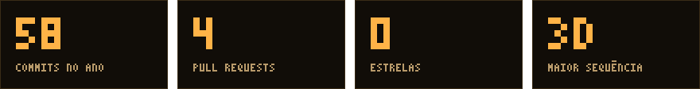
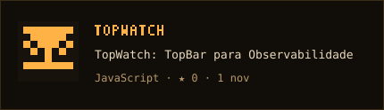
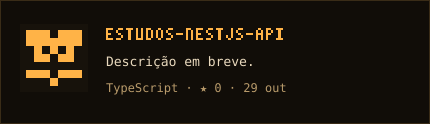
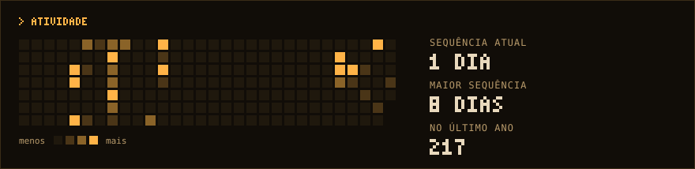

  

 

### `>` projetos

<!-- PROJETOS:INICIO -->

  
  

<!-- PROJETOS:FIM -->

  <a href="https://www.linkedin.com/in/vituhzzz/">LinkedIn</a> ·
  <a href="https://github.com/victorhugoantonio1?tab=repositories">Repositórios</a> ·
  sala atualizada a cada 4h por GitHub Actions

