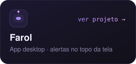
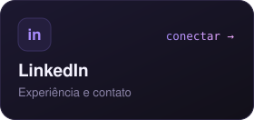
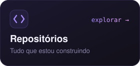

  

 

Sou o **Victor**, formado em **Análise e Desenvolvimento de Sistemas**, com **7 anos de mercado** em tecnologia. Estou construindo minha carreira como desenvolvedor e gosto muito de automatizar processos: se uma tarefa se repete, ela vira código.

 

  
  
  

<table>
  <tr>
    <td width="50%" valign="top">
      <b>Domínio</b>  
      <code>HTML</code> <code>CSS</code> <code>Observabilidade</code> <code>Virtualização</code> <code>Sysadmin</code>
    </td>
    <td width="50%" valign="top">
      <b>Em desenvolvimento</b>  
      <code>Java</code> <code>Python</code>
    </td>
  </tr>
</table>

  
<b>Ver o Farol em ação</b>

   
  
  
App desktop que fica numa barrinha no topo da tela e mostra alertas e chamados de APIs externas. Mascote animado, integrações via REST e JSON-RPC, testes automatizados e ambiente de teste no Docker.

### Atividade recente

<!-- ATIVIDADE:INICIO -->
- **[farol](https://github.com/victorhugoantonio1/farol)** · Laboratório Zabbix · 12 out
<!-- ATIVIDADE:FIM -->

<picture>
  <source media="(prefers-color-scheme: dark)" srcset="https://raw.githubusercontent.com/victorhugoantonio1/victorhugoantonio1/output/cobrinha-dark.svg" />
  
</picture>
